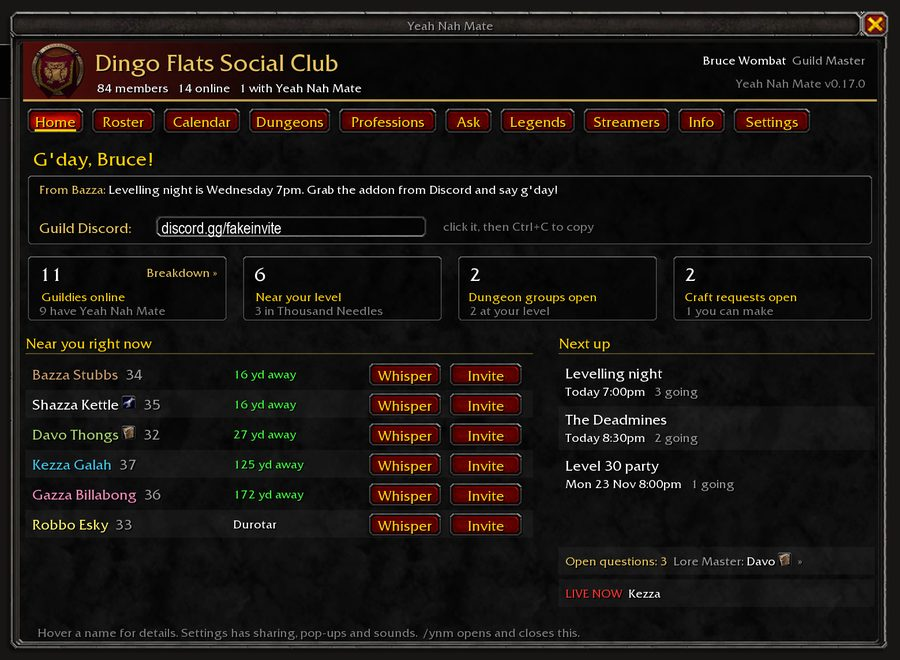
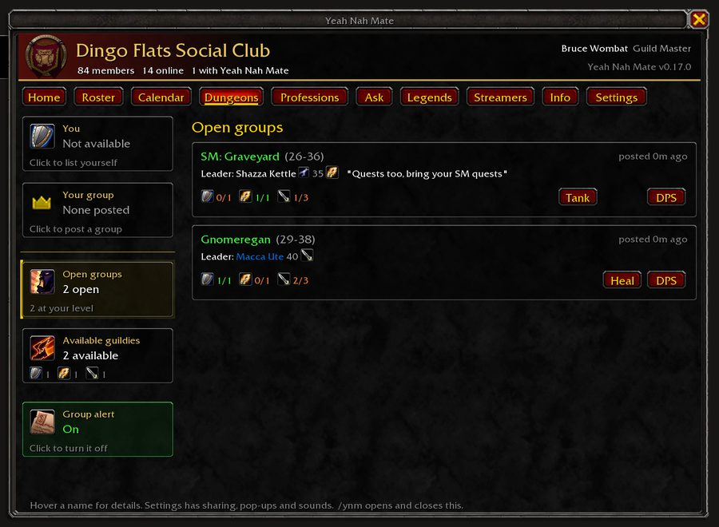

# Yeah Nah Mate

A guild addon for **WoW Forever**: your guildmates on the map, a levelling roster, guild dungeon
groups, a guild calendar, who can craft what, and questions and answers. Made in the
WoW Forever guild *Loktar Yeah Nah*; it works for any guild.

Everything is shared only with your guildmates who also run the addon, through the game's own guild
messages. Nothing goes to other players or any website. You choose whether your position and
professions are shared, and can turn it off any time.

**Download:** [CurseForge](https://www.curseforge.com/projects/1795554) · Open in game with `/ynm`.

## What it does

- **Map**: guildies as class-coloured dots on your world map and minimap.
- **Roster**: who's online, their level, zone and what they're doing; who's near your level.
- **Dungeons**: post a group or mark yourself available; guildies sign up by role; the leader invites with a click.
- **Calendar**: guild events with Going / Maybe / Can't, roles, reminders, and gathering the guild onto one layer.
- **Professions**: who in the guild can make what, even when they're offline; craft requests.
- **Ask**: questions to the guild with quest, item and dungeon links; the most helpful answerer is the Lore Master.
- **Legends, Streamers, Info**: guild titles, guildies' Twitch cards, the officers' message and Discord invite.
- **GM tab**: managers, which ranks moderate each tab, and milestone shout-outs in guild chat.

## How it's made

Yeah Nah Mate is designed, tested and run by zacslip for a real guild. Most of the code was written
with Claude (Anthropic's AI) in [Claude Code](https://claude.com/claude-code); commits made that way
end with a `Co-Authored-By: Claude` line. Every change is checked by the offline tests and in game
before it's released.

## Contributing

Bug reports, ideas and pull requests are welcome. See [CONTRIBUTING.md](CONTRIBUTING.md) for setting
up (Python and `pip install lupa`; no WoW needed for the tests), the rules every change keeps, and how
changes get in. How it works inside: [docs/ARCHITECTURE.md](docs/ARCHITECTURE.md). What changed in
each version: [CHANGELOG.md](CHANGELOG.md).

## Licence

MIT, see [LICENSE](LICENSE). Bundled libraries keep their own licences, see
[YeahNahMate/libs/LIBRARIES.md](YeahNahMate/libs/LIBRARIES.md).
